# Ferry

Share one keyboard and mouse between Hyprland machines on your local network. Push the pointer off
the edge of one screen and it continues on the next machine; the keyboard follows the pointer.

Ferry is built only for **Hyprland on [Omarchy](https://omarchy.org/)**. It has a Rust daemon
(`ferryd`), a `ferry` command-line tool, and an Omarchy shell plugin for the bar.

> **Status: 0.1.0, an early preview.** It is used daily between two machines. Expect rough edges,
> and run the same Ferry version on every machine.

## Quick start

You need two or more Omarchy machines on the same network. Do steps 1 and 2 on **every** machine.

**1. Build and install the package.**

```bash
git clone https://github.com/mmonari/ferry
cd ferry
bin/install          # builds the Arch package and installs it; pacman asks for sudo
```

On a slow machine, build once on a fast one and copy the package over. The build targets the
plain baseline of its arch (x86-64 or aarch64), so the package runs on every machine of that arch:

```bash
scp pkgbuild/ferry-*.pkg.tar.* other-machine:     # on the fast machine
sudo pacman -U ferry-*.pkg.tar.*                   # on the other machine
```

**2. Set up the machine**, as your own user (not root):

```bash
ferry setup          # shows each change and asks once
ferry doctor         # every row should read PASS; each WARN or FAIL comes with its fix
```

`ferry setup` puts the Ferry widget on the bar, starts `ferryd`, adds the key bindings and offers
to open UDP port 4243 in the firewall. Add `--dry-run` to see every change first.

**3. Pair two machines.** On the first machine:

```bash
ferry pair --accept
```

Then, within 120 seconds, on the second machine:

```bash
ferry pair <first-machine-host-or-ip>
```

Both screens show the same 6-digit code. Confirm on both. The Pair panel on the bar does the
same (`ferry ui pair`). With three or more machines, pair every two of them: three machines
take three pairings.

**4. Arrange the screens** like they stand on your desk. Open the Arrange panel from the Ferry
widget on the bar (or run `ferry ui arrange`), drag the monitors so their edges touch, and apply.
From a terminal:

```bash
ferry layout show                           # machine names and their monitors
ferry layout place netbook --below desktop  # also --above, --left-of, --right-of
```

The anchor can also be one monitor, such as `desktop:HDMI-A-1`. `--align start|center|end` picks
where along that edge the machine sits.

**5. Try it.** Push the pointer through an edge that touches the other machine, then type. To
come back, push the pointer back, or press **`Super+Ctrl+Escape`**: it always brings the keyboard
and mouse home.

## What it does



- **Edge crossings.** Arrange the machines' monitors on one shared layout. A pointer that leaves
  through a linked edge enters the next machine at the matching point.
- **Keybind crossings.** `Super+Ctrl+Alt` plus an arrow key moves the keyboard and mouse to the
  machine on that side, or back home, without touching the pointer.
- **Shared clipboard.** Copy text or an image on one machine, cross, and paste on the other.
  Only the list of types moves on a copy; the data moves when something pastes.
- **Bar widget.** Shows the state of each peer. Its panels arrange the layout, pair machines and
  change the settings.
- **Encrypted, LAN only.** Peers talk QUIC with mutual TLS 1.3. Each machine pins the other's key
  fingerprint when you pair them, and refuses everything else. There are no accounts and no cloud.

## Requirements

- Omarchy 4.5 with Hyprland 0.56.2 (Lua config) and xdg-desktop-portal-hyprland 1.4.1, the
  versions Ferry is tested on.
- Machines that can reach each other on **UDP port 4243**.
- To build: Arch's `rust` package (edition 2024). `bin/install` pulls it in if it is missing.

## Getting your input back

| How | What it does |
|---|---|
| `Super+Ctrl+Escape` | The escape chord. It always returns input to this machine, even if `ferryd` hangs. |
| `ferry release` | The same, from a terminal. |
| `ferry lock on` | No crossing starts from this machine until `ferry lock off`. |

Ferry also releases by itself:

- If a peer goes silent, held keys are released on the other machine within about 650 ms.
- Ferry never captures input while the screen is locked.

## Commands

| Command | What it does |
|---|---|
| `ferry status` | This peer, each peer's link, and the current state |
| `ferry go left\|right\|up\|down` | Move input to the machine on that side, or back home |
| `ferry doctor` | Check this machine; prints a fix for every problem it finds |
| `ferry ui arrange\|pair\|settings` | Open a panel of the bar widget |
| `ferry peers`, `ferry unpair` | List the pinned peers, or remove one |
| `ferry id`, `ferry trust` | Pair by hand: print this machine's fingerprint, or pin another's |
| `ferry clipboard on\|off\|toggle` | Share the clipboard with the other machines, or stop |
| `ferry config` | Read and change `config.toml` through `ferryd`, which checks every value |
| `ferry events` | Stream `ferryd`'s events as JSON lines, for frontend authors |

Every command takes `--json`. The socket API is documented in
[`docs/api/socket-api.md`](docs/api/socket-api.md).

## Troubleshooting

- **Start with `ferry doctor`** on both machines. It checks the daemon, Hyprland, the portal, the
  key bindings, the firewall and each peer, and prints a fix for each problem.
- **The machines don't connect.** Both must allow UDP port 4243. Omarchy's firewall blocks it until
  `ferry setup` opens it (`sudo ufw allow ferry`).
- **The pointer stops at the edge.** Only edges that touch in the layout are links. Check with
  `ferry layout show`, or open the Arrange panel.
- **Logs:** `journalctl --user -u ferryd -f`.

## Update and uninstall

To update, on every machine:

```bash
git pull
bin/install
systemctl --user restart ferryd    # the running daemon is still the old version
```

To uninstall:

```bash
ferry setup --undo                 # add --purge to also delete keys, peers and settings
sudo pacman -R ferry
```

`ferry setup --undo` prints the Hyprland and firewall lines it added; remove those yourself.
[`docs/packaging.md`](docs/packaging.md) has the details, and what the package installs.

## Known limitations

- **Hyprland on Omarchy only.** Other compositors, macOS and Windows are out of scope.
- **Same version on every machine.** Mixed versions are not tested.
- **Clipboard: text and images, no files.** A copy goes to the machine the pointer last crossed
  to or came from, and its data moves only when something pastes there (at most 32 MiB by
  default). `ferry clipboard off` stops sharing. The primary selection (middle-click) is not shared.
- **No network discovery yet.** Its settings exist, but nothing reads them.
- **With fcitx5:** the first modifier pressed in a crossing that starts right after the machine
  was a target can end the crossing, and the key chord lands on the local machine.

## License

MIT, see [`LICENSE`](LICENSE). Ferry includes code from
[gliff](https://github.com/omacom/gliff) under the MIT License; see [`NOTICE`](NOTICE).
